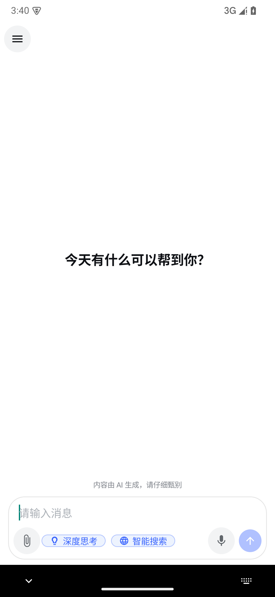
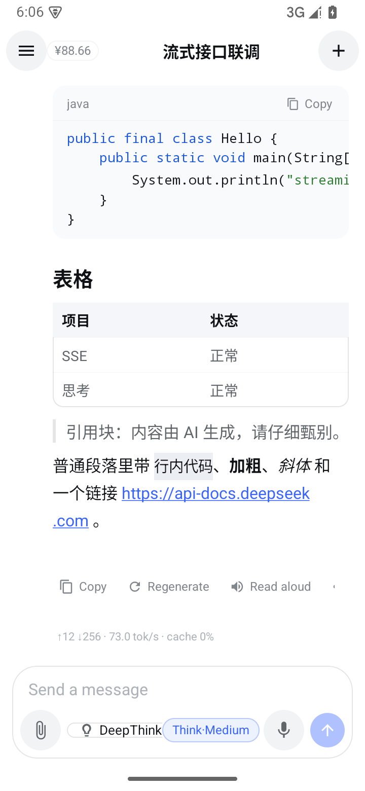
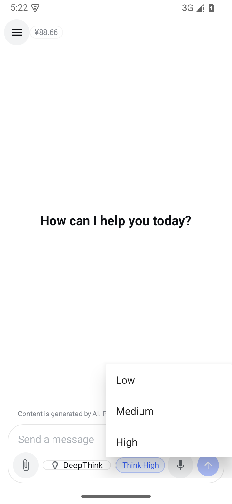
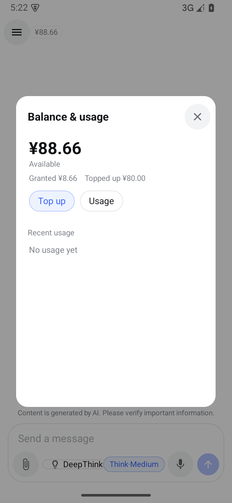
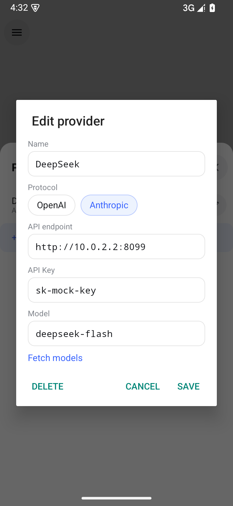

# Serein Chat

**纯原生、零依赖的 Android AI 聊天客户端。** 直连模型服务商 API，不经过任何中转服务器。

<!-- 徽章区：把 Treetore/serein-chat 换成你的 GitHub 用户名与仓库名 -->
<p align="center">
  <a href="https://github.com/Treetore/serein-chat/releases"></a>
  
  
  
  
</p>

<p align="center">
  <!-- 访问量小插件：无需自建服务，页面加载即计数 -->
  <a href="https://github.com/Treetore/serein-chat"></a>
  <!-- 备用计数器（如上方失效可换用）
  <a href="https://github.com/Treetore/serein-chat"></a>
  -->
</p>

---

## 免责声明

> **本项目是独立开发的第三方开源客户端，与 DeepSeek（杭州深度求索）、OpenAI、Anthropic、Google 或任何模型服务商均无从属、代理、赞助或背书关系。**
>
> 1. 应用内不内置任何 API Key，也不提供任何模型服务。你需要自备服务商账号与密钥，费用由你与该服务商结算。
> 2. 所有对话内容仅在你的设备与服务商接口之间点对点传输；本项目作者不收集、不中转、不存储你的对话与密钥。
> 3. 模型输出的内容由对应服务商生成，其准确性、合法性与合规性由服务商与使用者自负；请勿用于违法违规用途。
> 4. 项目名称、图标与代码中出现的第三方商标（如 DeepSeek）仅用于**描述接口兼容性**，归各自权利人所有。
> 5. 本软件按 MIT 协议「按原样」提供，不附带任何明示或暗示担保；因使用本软件造成的任何直接或间接损失，作者不承担责任。
> 6. 若权利人认为本项目存在侵权，请通过 Issue 联系，核实后会调整命名或移除相关内容。

## 隐私与数据安全

设计原则：**没有账号、没有埋点、没有云端中转。**

| 项目 | 做法 |
| --- | --- |
| API Key 存储 | Android Keystore 生成 AES-256-GCM 密钥加密后写入 SharedPreferences；密钥不可导出，卸载即销毁 |
| 密钥外泄面 | 不写日志（源码无 `Log.*`）、不随系统备份（`allowBackup=false`）、不进入导出包 |
| 网络 | 默认禁止明文 HTTP（`networkSecurityConfig`），仅 `localhost`/`10.0.2.2` 调试地址放行；密钥只发往你填写的 endpoint |
| 剪贴板 | 复制内容标记 `EXTRA_IS_SENSITIVE`，系统剪贴板预览不显示正文 |
| 对话数据 | 仅存本机 SQLite；导出 ZIP 只含会话与消息，不含密钥与账号信息 |
| 权限 | 仅 `INTERNET` / `ACCESS_NETWORK_STATE` / `RECORD_AUDIO`（语音输入，可拒绝） |
| 第三方 SDK | 无。不使用统计、崩溃上报、广告、推送等任何 SDK |

审查记录见 [docs/SECURITY.md](docs/SECURITY.md)。

## 功能

- **双协议接入**：OpenAI 兼容（`/v1/chat/completions`）与 Anthropic 兼容（`/v1/messages`），可配置多个服务商并一键切换
- **能力探测**：拉取 `/models` 后按命名推断视觉/工具/思考能力，推断不出可手动勾选；能力直接约束附件入口与请求字段
- **流式渲染**：SSE 增量解析，逐字渐映（按屏幕刷新率定帧）、Markdown 实时排版、代码块高亮与复制
- **思考与联网**：思考块可折叠；搜索/读链来源卡片；思考强度三档（低/中/高）
- **余额与用量**：官方服务显示余额（30s 自动刷新，可查看余额明细与近 7 天用量），每轮回复底部显示 `↑输入 ↓输出 · tok/s · 缓存命中率`
- **历史互通**：与官方 `deepseek_data-*.zip`（`export_format_version=3`）双向导入导出
- **本地化体验**：中英双语、深浅色与自定义强调色、自定义背景图、草稿、会话搜索、编辑重发、分支切换、分享、朗读
- **无 Gradle、无 AndroidX、无 OkHttp**：手写 `aapt2 → javac → d8 → zipalign → apksigner` 流水线，APK 约 700 KB

## 截图

| 欢迎页 | 流式对话 | 思考强度 |
| --- | --- | --- |
|  |  |  |

| 余额与用量 | 服务商 | 深色 |
| --- | --- | --- |
|  |  |  |

## 构建

环境：JDK 17+、Android SDK（build-tools 34+、platform android-35）。

```powershell
# 先改 build.ps1 顶部的 SDK / JDK 路径
.\build.ps1                    # 产出 out/SereinChat-1.00.apk
.\build.ps1 -Task compile-only
.\build.ps1 -Task clean
```

首次构建会自动生成 `keystore.jks`（口令 `android`）。**发布前请替换为你自己的签名**：

```powershell
keytool -genkeypair -keystore release.jks -alias serein -keyalg RSA -keysize 2048 -validity 10000
```

安装：

```bash
adb install -r out/SereinChat-1.00.apk
```

## 配置服务商

| 字段 | 说明 |
| --- | --- |
| 协议 | OpenAI 兼容 / Anthropic 兼容 |
| 接口地址 | 例如 `https://api.deepseek.com`、`https://api.openai.com`、自建网关 |
| API Key | 只存本机，Keystore 加密 |
| 模型 | 可点「拉取模型列表」自动获取，也可手动填写 |

> 使用 DeepSeek 官方接口时：地址填 `https://api.deepseek.com`，协议选 **Anthropic 兼容**，密钥在 [开放平台](https://platform.deepseek.com/api_keys) 创建。

## 目录结构

```
app/
  AndroidManifest.xml
  res/                       资源（双语文案、图标、网络安全配置）
  src/com/serein/chat/
    MainActivity.java        编排：发送、流式、滚动、主题、导入导出
    api/                     Api（双协议流式）、Sse、ChatRequest、Turn
    data/                    Db、Prefs、Provider、Models、Usage、SecureStore、HistoryArchive
    md/                      自研 Markdown 解析与渲染
    ui/                      抽屉、输入栏、消息行、设置面板、主题、动画
build.ps1                    无 Gradle 构建流水线
docs/                        截图、安全审查记录
```

## 更新日志

见 [CHANGELOG.md](CHANGELOG.md)。当前版本 **v1.00**。

## 许可证

[MIT](LICENSE)。可自由使用、修改、再分发，需保留版权声明；使用风险由使用者承担。
